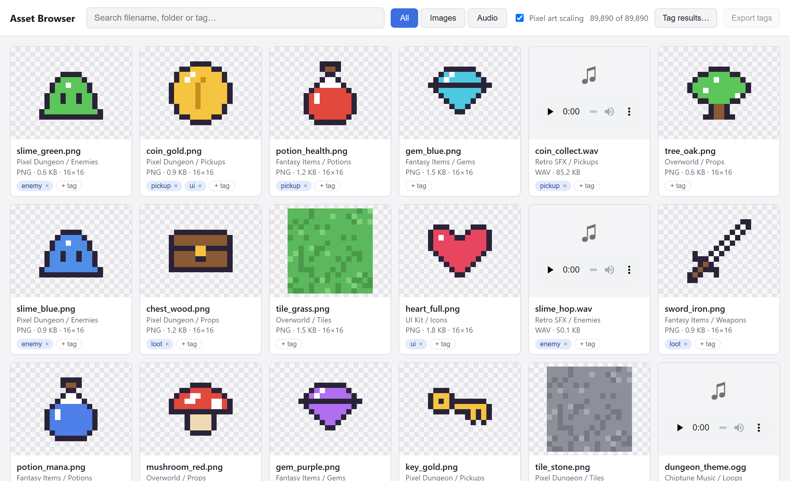

*The real `browser.html`, shown with a demo catalog. The pixel art is placeholder art I generated to stand in for my licensed assets.*

## The problem

My game asset library had grown to **89,890 files (27.6 GB) across 142 packs**: sprites, tilesets, sound effects, music. Finding the right sprite or sound meant clicking through folders one at a time, with no way to search across packs, preview audio in place, or tag files by how I'd actually use them.

## What it does

- **Catalogs everything**: one command scans the whole library into a database and prints a summary by type and extension
- **Browses it visually**: a grid of thumbnails for 47,681 images and inline players for 36,210 audio files
- **Searches instantly** across filename, folder, pack, and tags, with image/audio filters
- **Tags as you go**: tag one card, or tag every result of a search in one step
- **Runs fully offline**: no server, no install beyond Python and Pillow. You open an HTML file and it works.

## How it works

It's three small pieces with a clear hand-off between them:

1. **`catalog.py`** walks the library and writes one row per file to SQLite: path, pack, folder, type, size, and image dimensions. It reads only each image's header to get dimensions, inserts in batches of 1,000, and does the full rescan in a single transaction, so an interrupted scan never leaves a half-written catalog.
2. **`export_json.py`** turns the database into JSON for the browser. Browsers won't let a page opened from disk (`file://`) load a local JSON file, so it also writes the same data as a small script the page *can* load. The page falls back to a file picker if only the JSON is present.
3. **`browser.html`** is a single self-contained page with no frameworks or build step, and it follows the system's light or dark mode.

## Built to stay fast with 90,000 files

Loading tens of thousands of thumbnails and audio players at once would freeze any browser, so the page only does work for what's on screen:

- **Infinite scroll** renders 200 cards at a time as you approach the bottom
- **Lazy loading**: images load only when scrolled into view, and audio doesn't load until you press play
- **Debounced search** waits for a pause in typing, then matches against a precomputed search string per asset
- **One sound at a time**: starting a clip pauses whatever else is playing

It also has a few quality-of-life touches: a lightbox for full-size images on a checkerboard background (so transparency is visible), and a **pixel-art scaling** toggle that keeps retro sprites crisp instead of blurry.

## Tags that survive rescans

Tagging needed to be instant in the browser but also durable. Here's the round trip:

1. Tag edits save in the browser immediately, and an **"N unsynced"** counter shows what hasn't been stored yet.
2. **Export tags** downloads a `tags.json` file.
3. `import_tags.py` finds the newest export in Downloads, merges it into the database, and regenerates the browser data.
4. On reload, the page sees the edits are now stored and clears the unsynced count on its own.

Tags are keyed by **file path** rather than database row, so they survive a full rescan of the library.
