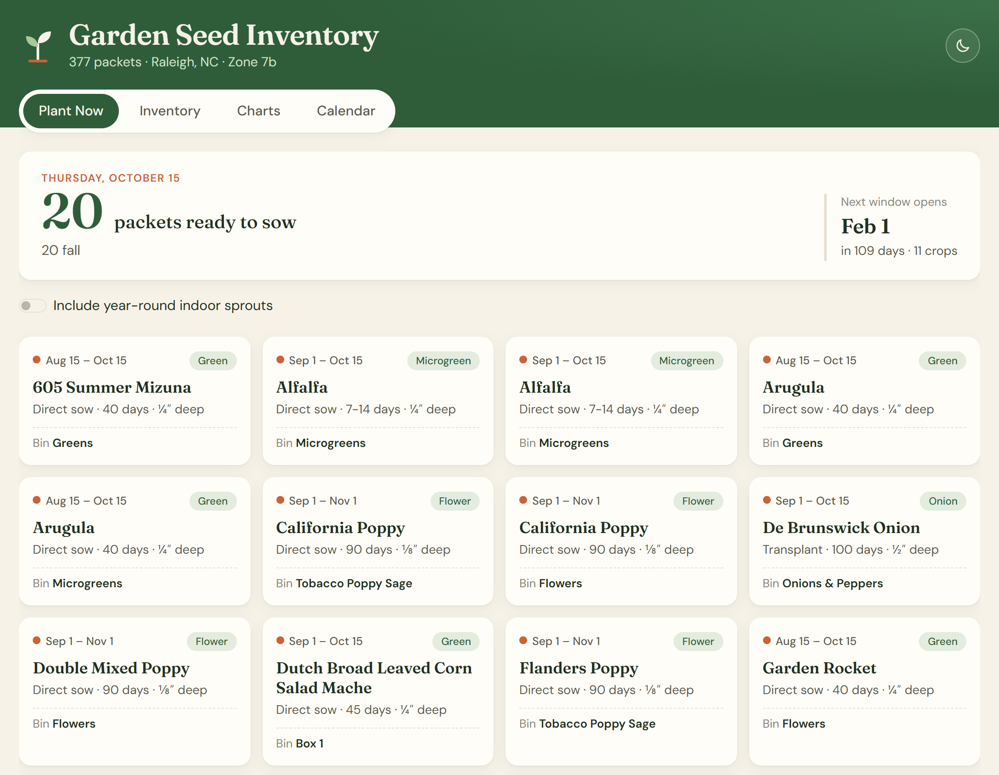
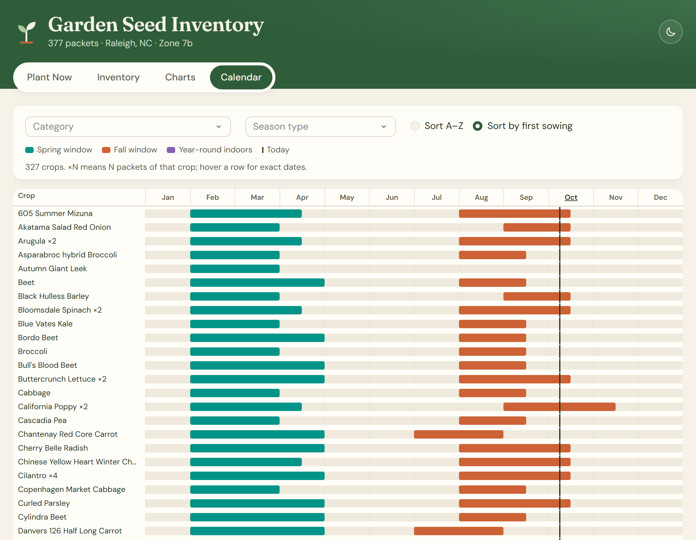

*The Plant Now tab on the day I published this. The app runs on Render's free tier, so if it's been idle, give it up to a minute to wake up.*

## The problem

My seed collection had grown to **377 packets**: 327 different crops from 9 seed companies, stored across 21 bins. Two things kept going wrong:

- **I lost track of what I had.** I couldn't remember whether I owned something, or which bin it was in, without digging through all of them.
- **I missed planting windows.** Every crop has its own spring and fall window for Raleigh, and there was no easy way to see what should go in the ground *this week*.

## Building the dataset

I catalogued the basics by hand: crop, variety, seed source, and storage bin. Looking up growing details for 377 packets one at a time wasn't realistic, so I used **AI to enrich the inventory**. It filled in planting method, days to maturity, spacing, seed depth, season type, and Raleigh-specific spring and fall planting windows. Each row also records a **match confidence** rating, so I could see how sure the enrichment was about that crop.

The result is a single CSV that drives the whole app. To update the data, I edit the spreadsheet and push, and the site redeploys on its own.

## What it does

The dashboard has four tabs:

- **Plant Now**: every packet whose window includes today (Raleigh time), with sowing method, depth, and the bin to pull it from, plus a countdown to the next window that opens
- **Inventory**: the full collection, filterable by category, season, planting method, and heirloom status, with text search and a **Download CSV** button for whatever you've filtered
- **Charts**: the collection broken down by category, seed source, season type, and heirloom vs. hybrid
- **Calendar**: one row per crop across the year, with spring and fall windows and a line for today

*The Calendar tab, sorted by first sowing date. The line marks today.*

## Turning messy text into dates

The planting windows arrive as text like "Mar 1 - May 1", so the app parses them into real date ranges. The parser accepts the ways people actually write dates: abbreviated or full month names, hyphens or en dashes, missing spaces, "Year-round indoors", and "N/A". It also handles **windows that wrap the new year**, like "Nov 15 - Feb 1", so a winter window still counts as open in January.

To keep bad data from slipping through quietly:

- A **check script** reports the CSV's structure and lists any window text it couldn't parse, and it exits with an error so the problem can't be missed
- The app loads and validates the CSV **at startup**, so a broken file fails the deploy instead of breaking the page for a visitor

## Tested

Automated tests cover the parser's edge cases: every accepted date format, junk input, inclusive start and end dates, windows that wrap the new year, the half-month calendar slots, and the countdown to the next window. A smoke test loads the real 377-row CSV to confirm every window parses cleanly.

## Small details

- **Dark mode** follows your device setting, remembers your choice, and never flashes the wrong theme on load
- On phones, the **filters fold behind a button**, so the table and calendar get the screen
- It runs as a single server process with multiple threads, which keeps memory use within **Render's free tier**
