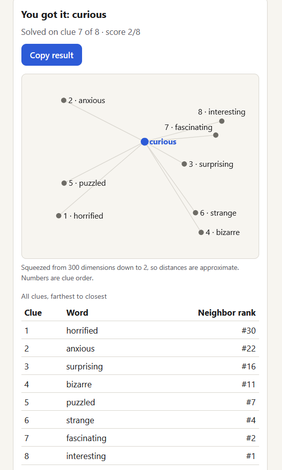

*The end screen: the answer's neighborhood squeezed onto a 2D map, and every clue with its neighbor rank.*

## The idea

Every day there's a hidden word. You see one clue at a time: words that are close to it **in meaning**, starting with a distant neighbor and getting closer with every wrong guess. Wrong guesses also get hot/cold feedback based on how close in meaning they are.

## How it works

The clues come from **GloVe word vectors**, which place 400,000 words in a 300-dimensional space where similar words sit near each other. A **Python pipeline** filters that down to about 28,000 common English words, finds each answer's nearest neighbors, and picks 8 clues spaced from the 30th-closest to the closest. It skips giveaways (plurals, shared roots), rare words and anything on a blocklist. A validation script checks all 598 puzzles every time the data is rebuilt.

## No server, no API

Everything runs in the browser. The game ships a compressed copy of the vectors (96 numbers per word, about 2.7 MB) and ranks your guesses on your device. Stats and streaks live in local storage. There's a plain-language **How it works** page with a 2D map of each puzzle's neighborhood, revealed once you've finished.

## Squeezing the vectors

The full vectors are far too big to ship to a phone, so the pipeline shrinks them in two steps. **PCA** cuts each word from 300 numbers to 96, and each number is then stored as a single byte. The test that matters is whether words still rank in the same order. Against the full vectors, the compressed set keeps a **0.91 rank correlation**. I tried 64 dimensions first, but it only reached 0.86.

## Playing fair

- **Hot/cold feedback** comes from where your guess ranks among all 27,780 words: Hot in the top 10, then Warm, Mild, Cool and Cold
- **Nothing offensive** can appear as an answer or a clue: a public blocklist plus my own additions filter both
- **Answers are obfuscated** in the data file, so they can't be read at a glance in your browser's developer tools
- **Practice mode** replays past puzzles, and the **share line** shows how you did without giving away the word
- Every data source, from the GloVe vectors to the dictionary and the blocklist, is **credited with its license**

## Tested

156 front-end tests cover guess matching, UTC date edges, streak rules, share text, and **WCAG AA color contrast** in every theme. One test lays out the map for every real puzzle and fails if any labels overlap. Another 40 pipeline tests check the clue filters and data validation. Clues are announced to screen readers as they appear, and there's a light/dark theme toggle.
