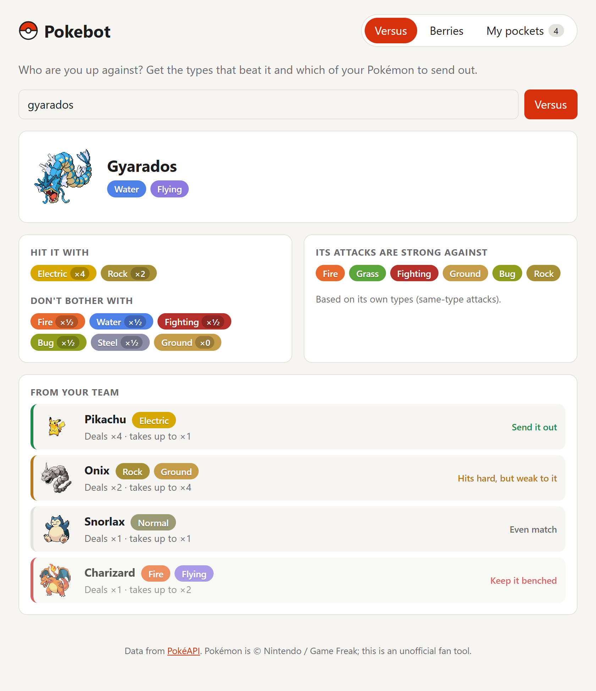

*Pokebot's Versus tab rating a saved team against Gyarados. Data from PokéAPI. Pokémon is © Nintendo / Game Freak; this is an unofficial fan project.*

## Where it started

Over four years ago I took **Harvard's CS50** on edX, and my capstone was Pokebot: a Discord bot that helped you choose the right Pokémon and berries based on what you already had.

It was written in Python. You typed commands in chat, like `!versus gyarados`, `!addmon pikachu` or `!flavor sweet`. The bot called [PokéAPI](https://pokeapi.co) for the data and saved each player's Pokémon and berries in a small SQLite database, keyed by their Discord user. Ask it about an opponent and it suggested types to use and which of your saved Pokémon to try.

## Rebuilding it for the web

A Discord bot needs a server running around the clock and a database to host. For a portfolio piece I wanted something anyone could open in a browser. So I rebuilt it as a **static React + TypeScript app** on Cloudflare Pages:

- The browser calls PokéAPI directly, so there's **no server and no database** to run
- Your team and berries ("pockets") are saved in the browser instead of SQLite, with **backup and restore** to a JSON file
- Name fields **autocomplete** from PokéAPI's full Pokémon and berry lists
- Three tabs carry over the bot's commands: **Versus**, **Berries** (browse by flavor or look one up), and **My pockets**

## Getting the matchups right

The original bot built its advice by combining lists of "takes double damage from" for each of the opponent's types. That works for single-type Pokémon, but it breaks down for dual types. Against Gyarados (Water/Flying), it recommended **Ice**, which is strong against Flying but weak against Water, so it actually lands at ×1. And it couldn't tell you that **Electric hits ×4**.

The new version uses the **full type chart** and multiplies across both of the opponent's types, so it handles ×4 weaknesses, ×¼ resistances and ×0 immunities correctly. For any opponent it shows:

- **Hit it with**: every type that deals more than ×1, with its exact multiplier
- **Don't bother with**: types it resists or is immune to
- **Its attacks are strong against**: the types its own attacks hit super-effectively

## Rating your team

The part I most wanted from the start: which of *my* Pokémon should I send out? Each saved Pokémon is rated two ways: how hard it hits the opponent, and how hard the opponent hits back. It then gets one of four verdicts:

- **Send it out**: hits for ×2 or more and isn't weak to the opponent
- **Hits hard, but weak to it**: a gamble that trades blows
- **Even match**: no edge either way
- **Keep it benched**: the opponent has the advantage

The team is sorted best pick first, so the answer is at the top.

## Being a good API citizen

PokéAPI is free and community-run, and it asks apps to cache what they fetch. Pokebot keeps only the fields it needs from each response and caches them both in memory and in the browser. Looking up the same Pokémon twice never hits the network again.

## Tested

The type math has unit tests built on real matchups: Pikachu vs. Gyarados should be ×4 and "Send it out", Ground vs. Gyarados should be ×0, Golem should beat Charizard, and a mixed team should sort in the right order. If I change the logic, the tests tell me right away whether a recommendation broke.
